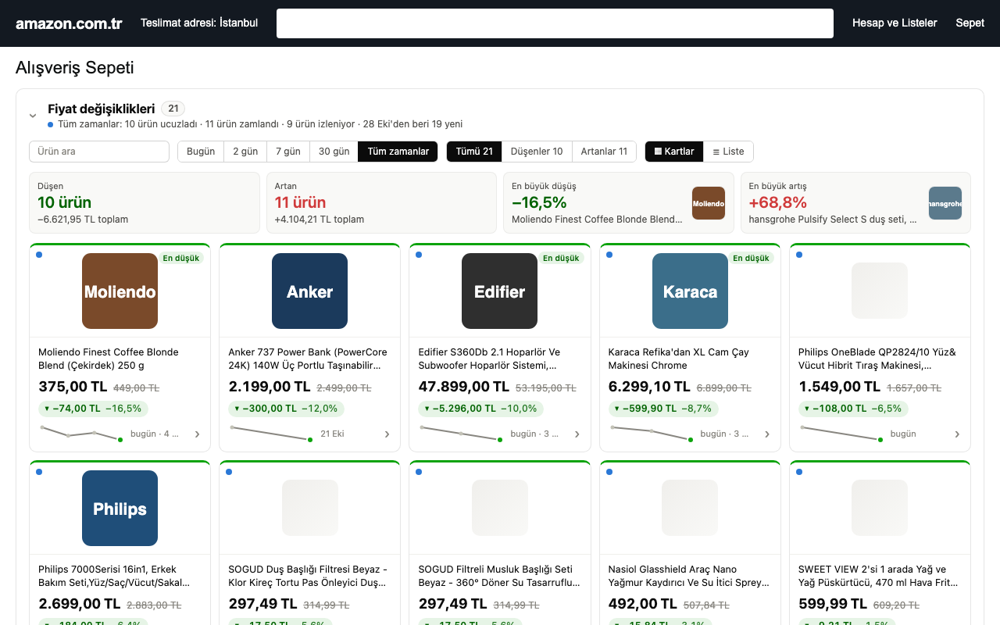
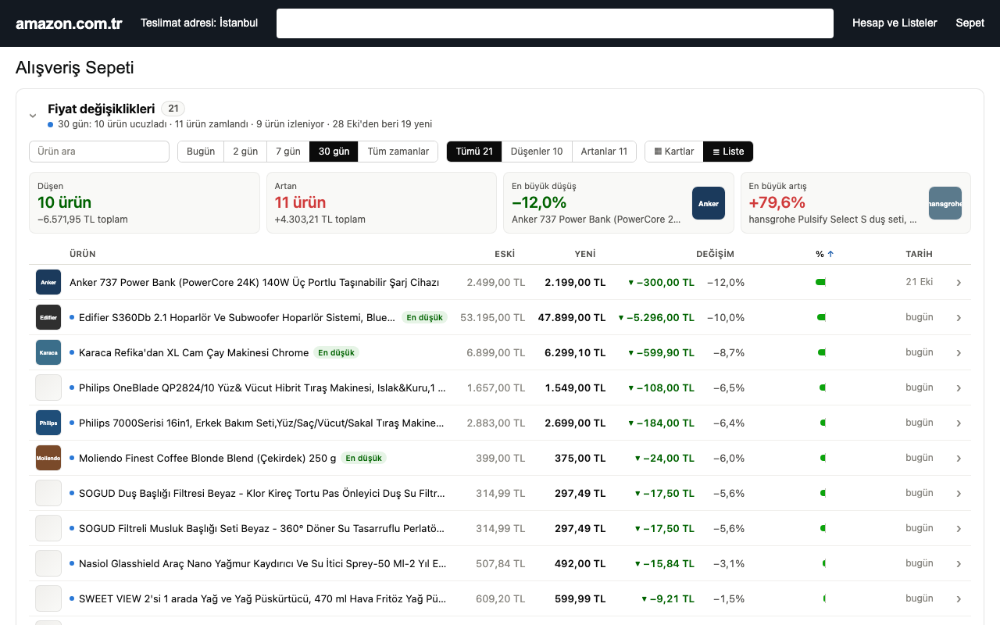

# Cart Price Changes for Amazon

A small browser extension that turns Amazon's wall of "price changed" sentences
into something you can read at a glance, and keeps watching the prices of
everything in your cart and saved-for-later list on every visit.



Amazon shows its price-change box only once, as one long sentence per item, and
only for what changed since you last looked. This extension records prices
itself, so the picture is always there and grows over time.

## What it does

- **Cards or list.** Cards show each product with its picture, the new price
  large, the old price struck through, a green or red change pill, a sparkline
  and the date; the top edge is green for a drop and red for a rise. List is a
  dense table with sortable columns and a diverging bar per item.
- **Its own price history.** On every cart visit it reads the current price of
  each item in your cart and saved-for-later list and records a point whenever
  a price moved. Amazon's own notices are folded in. Click a product for its
  full history.
- **Period filter.** Today, 2 days, 7 days, 30 days or all time; each row shows
  the change over that period, however many steps lie between.
- **Summary** tiles (dropped, increased, biggest drop, biggest increase, both
  clickable) and a one-line summary such as "7 days: 3 items cheaper · 1 pricier".
- **Filters and search**, new-since-last-visit markers, a "lowest seen" badge,
  CSV export, collapse.
- **Turkish and English** interface, following the page language. Works on
  amazon.com.tr, amazon.com, .co.uk, .de, .fr, .it, .es, .nl, .se, .pl, .com.be,
  .ca, .com.mx, .com.br, .com.au, .co.jp, .in, .sg, .ae, .sa and .eg.
- **Private by design.** No permissions, no server, no analytics. Everything is
  stored in your browser, for the Amazon site you use. See [PRIVACY.md](PRIVACY.md).



## Install

Works in Dia, Chrome, Arc, Brave, Edge, Vivaldi and other Chromium browsers.

**Chrome Web Store** — listing in review; this section will carry the link.

**Userscript (one click, auto-updates).** Install
[Tampermonkey](https://www.tampermonkey.net/) or
[Violentmonkey](https://violentmonkey.github.io/), then open
[amazon-cart-price-changes.user.js](https://raw.githubusercontent.com/Coursion-Studio/amazon-cart-price-changes/main/amazon-cart-price-changes.user.js)
and confirm. Updates arrive on their own.

**Unpacked extension.** Download the zip from the
[latest release](https://github.com/Coursion-Studio/amazon-cart-price-changes/releases/latest)
and unzip it, or clone this repo. Then open `dia://extensions` (or
`chrome://extensions`), turn on **Developer mode**, click **Load unpacked** and
choose the folder.

Then open your Amazon cart. Scroll through the saved-for-later list once per
visit: Amazon only loads those items as you reach them.

## Development

```bash
npm test              # parser and history unit tests (node --test)
npm run shot          # headless Chrome screenshot of test/cart/fixture.html
npm run store-shots   # 1280x800 store screenshots + 440x280 promo tile into store/
npm run package       # builds the userscript and dist/<name>-<version>.zip
```

`parse.js` is the pure part: price and direction parsing, the price history
model, period windows, sorting and formatting. `content.js` reads the page,
builds the panel and keeps it in sync. `styles.css` is scoped to the panel.
`test/cart/fixture.html` stands in for the cart page (built from a real
amazon.com.tr cart); `?seed=1` seeds a history, `&nolive=1` removes Amazon's
box, `&win=7d`, `&view=list` and `&expand=<ASIN>` pick a state.
`store/listing.md` has the Chrome Web Store listing text and publishing steps.

## Not affiliated with Amazon

Amazon is a trademark of Amazon.com, Inc. This project is an independent tool
and is not endorsed by or affiliated with Amazon.

MIT © Coursion Studio
