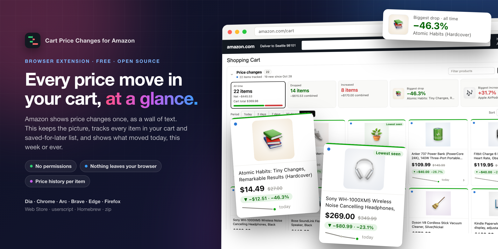
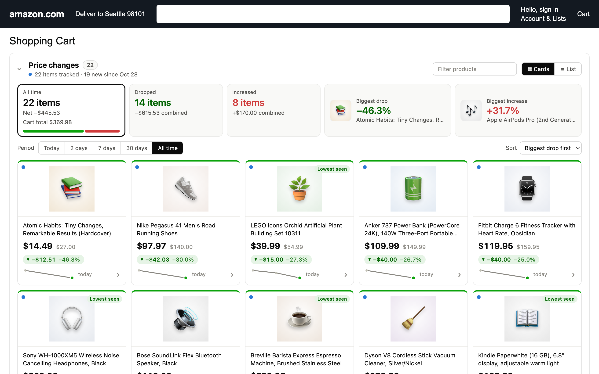
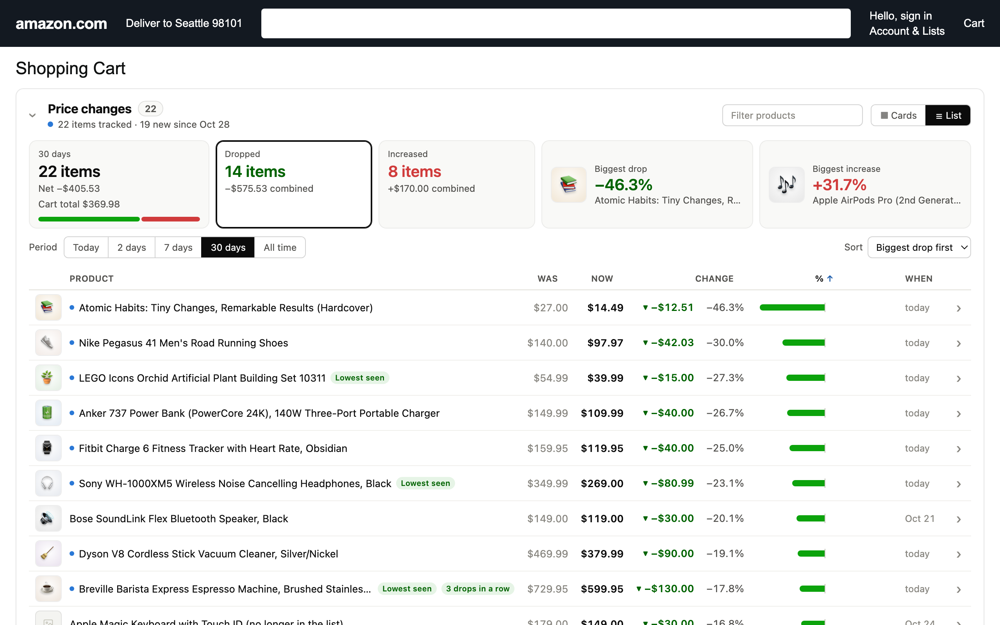
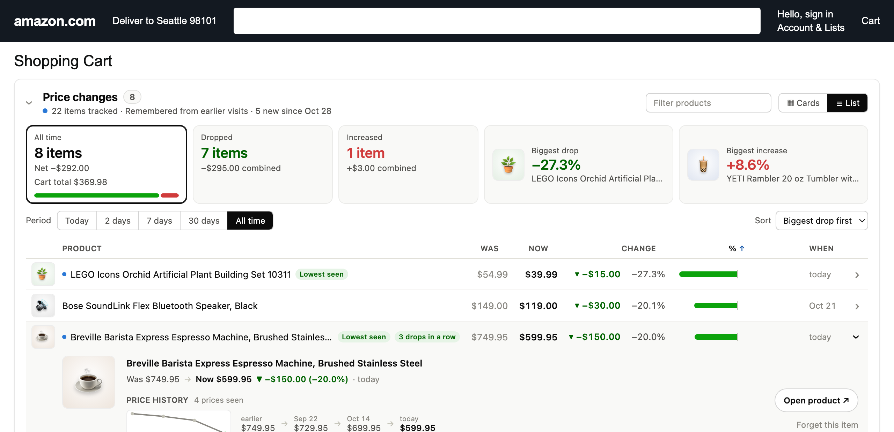

<p align="center">
  
</p>

<h1 align="center">Cart Price Changes for Amazon</h1>

<p align="center">
  Every price move in your Amazon cart and saved-for-later list, as cards or a table, with history.<br>
  Works in Dia, Chrome, Arc, Brave, Edge and Firefox. No permissions, no server, nothing leaves your browser.
</p>

<p align="center">
  <a href="https://github.com/Coursion-Studio/amazon-cart-price-changes/releases/latest"></a>
  <a href="LICENSE"></a>
  
  
</p>

<p align="center">
  
</p>

## The problem

Amazon does tell you when prices in your cart change. It just does it badly:

- **One long sentence per item**, in a wall of yellow text. Twenty items, twenty sentences.
- **Shown once.** Reload the page and the box is gone.
- **Only since you last looked.** A price that moved three times last month shows up as one change, or not at all.

## What this does instead

It replaces that box with a panel you can read in a second, and it keeps its own
record so the picture is always there and grows over time.

| | |
|---|---|
| **Cards** | Product picture, new price large, old price struck through, a green or red pill with the change in money and percent, a sparkline of every price seen, and the date. The top edge is green for a drop, red for a rise. |
| **List** | The same data as a dense table: sortable columns, a diverging bar per item, tabular numbers. |
| **Summary row** | How many items dropped or rose and by how much, the biggest move each way with its picture. The tiles are filters: click *Dropped* to see only drops. |
| **Period** | Today, 2 days, 7 days, 30 days or all time. Each row shows the change over that period, however many steps lie between, and the summary follows. |
| **History** | On every visit the extension reads the current price of every item in your cart and saved-for-later list and records a point when a price moved. Amazon's own notices are folded in. Click any product for its full history. |
| **Alerts** | Turn them on in the toolbar popup and the extension checks your cart on a schedule you choose, even with no Amazon tab open, and notifies you when an item drops by your chosen percentage or reaches your target price. The icon shows the number of new drops. |
| **Targets** | Set a target price in any product's details. It shows as a chip on the card and fires an alert when reached. |
| **Signals** | A blue dot on everything that changed since your last visit. *Lowest seen*, *3 drops in a row*, *Back to an earlier price*, *Target reached*. |
| **Cart total** | The first tile shows what everything in your cart costs now and how that moved over the period. |
| **Also** | Search, sort menu, collapse, CSV export, English and Turkish interface following the page language. |

<p align="center">
  
</p>

<p align="center">
  
</p>

<p align="center">
  
</p>

## Install

Pick whichever fits. All of them give you the same extension.

| Channel | Browsers | Updates | How |
|---|---|---|---|
| **Userscript** | Any Chromium browser or Firefox with [Tampermonkey](https://www.tampermonkey.net/) or [Violentmonkey](https://violentmonkey.github.io/) | Automatic | Open [amazon-cart-price-changes.user.js](https://raw.githubusercontent.com/Coursion-Studio/amazon-cart-price-changes/main/amazon-cart-price-changes.user.js) and confirm |
| **Homebrew** (macOS) | Dia, Chrome, Arc, Brave, Edge | `brew upgrade` | `brew install Coursion-Studio/tools/amazon-cart-price-changes`, then load the folder it prints |
| **Release zip** | Dia, Chrome, Arc, Brave, Edge | Manual | Download from [Releases](https://github.com/Coursion-Studio/amazon-cart-price-changes/releases/latest), unzip, load the folder |
| **Firefox zip** | Firefox | Manual | `…-firefox.zip` from Releases, via `about:debugging` → Load Temporary Add-on |
| **Safari** (macOS) | Safari | Manual | Open `safari/` in Xcode, run the app once, enable the extension in Safari → Settings → Extensions |
| **Chrome Web Store** | Dia, Chrome, Arc, Brave, Edge | Automatic | Listing in review; the link will appear here |

**Loading a folder** (Homebrew or zip): open `dia://extensions` or `chrome://extensions`,
turn on **Developer mode**, click **Load unpacked**, choose the folder. After an
update, click the reload icon on the extension's card.

Then open your Amazon cart. Scroll through the saved-for-later list once per
visit: Amazon only loads those items as you reach them, and the extension can
only record what is on the page.

## How it works

- `content.js` runs on Amazon storefront pages only. On the cart page it reads
  Amazon's price-change notices (if any) and the name, price and picture of
  each item in the cart and saved-for-later lists.
- Every price is stored as a point `{ time, price }` per product in the
  browser's extension storage, keyed by Amazon site. A new point is added only
  when the price moved. Amazon's "was X, now Y" notices add the earlier price
  too.
- With alerts on, `background.js` fetches your cart page (and the pages of
  tracked products that were not in it) on the chosen interval, records the
  prices the same way, and notifies you about drops. It only does this after
  you grant the alarms, notifications and Amazon-site permissions from the
  popup; nothing is requested at install.
- For the chosen period, a product's change is the price just before the
  period against the price now. Nothing changed in the period means the
  product is not listed.
- Records older than a year are dropped. **Clear history** removes everything;
  **Forget this item** removes one product.

Supported storefronts: amazon.com.tr, amazon.com, .co.uk, .de, .fr, .it, .es,
.nl, .se, .pl, .com.be, .ca, .com.mx, .com.br, .com.au, .co.jp, .in, .sg, .ae,
.sa and .eg. Prices are parsed in both `1.234,56` and `1,234.56` styles.

## Privacy

Nothing leaves your browser. No account, no server, no analytics. The only
install-time permission is `storage` for its own data. The only network
requests go to your Amazon site: product pictures, a product's own page when a
remembered item has no picture, and, with alerts on, your cart page and
tracked product pages on the schedule you chose. Details in
[PRIVACY.md](PRIVACY.md).

## Development

```bash
npm test               # unit tests for parsing, history and formatting (node --test)
npm run shot           # screenshot the demo cart at test/cart/fixture.html
npm run store-shots    # 1280x800 store screenshots, README images and the promo tile
npm run package        # userscript + Chrome/Edge/Dia zip + Firefox zip into dist/
npm run safari         # regenerate safari/ (Xcode project) from the packaged extension and build it
scripts/update-formula.sh   # after a GitHub release: refresh the Homebrew formula
```

Layout:

```
manifest.json        MV3 manifest, content script on Amazon storefronts, worker, popup
parse.js             pure: prices, direction words, history model, periods, signals, formatting
scan.js              pure: cart page and product page HTML parsers for the worker
content.js           the page: find Amazon's notices and list items, build and refresh the panel
background.js        alerts: scheduled checks, notifications, toolbar badge
popup.html/js/css    toolbar popup: alert settings, check now, recent drops, targets
styles.css           scoped to #apc-panel
safari/              Xcode project for Safari, generated by scripts/safari.sh
test/parse.test.js   unit tests
test/make-fixture.py generates test/cart/fixture.html, a demo cart with made-up products
scripts/             package, userscript build, screenshots, Homebrew formula update
store/               Chrome Web Store assets and listing text (store/listing.md)
```

The demo cart accepts `?seed=1` (seeded history), `&nolive=1` (no Amazon box),
`&win=7d`, `&view=list`, `&filter=down`, `&expand=<ASIN>` and `&shot=1`
(compact layout for screenshots). The content script treats it as a cart page
because it lives under a `cart/` path.

## Questions

**Only a few items show up.** The record starts when you install. Amazon's own
box only lists what changed since you last looked; from now on every visit
adds to the history, and the period selector widens the view.

**No picture for an item.** Amazon loads pictures lazily; the extension picks
them up as they arrive. For an item that is not on the page, it tries Amazon's
image service by ASIN and then fetches that product's page on the same site
once to read its picture. If a storefront's markup differs, click **Copy
diagnostics** in the footer and open an issue with the result.

**Safari?** Open the project in `safari/` with Xcode, run it once, then enable
the extension in Safari → Settings → Extensions (for an unsigned local build,
also tick Develop → Allow Unsigned Extensions). Alerts use scheduled checks;
Safari has no notification API for extensions, so there the badge and the
popup carry the news.

## Not affiliated with Amazon

Amazon is a trademark of Amazon.com, Inc. This is an independent tool and is
not endorsed by or affiliated with Amazon.

MIT © [Coursion Studio](https://coursion.studio)
