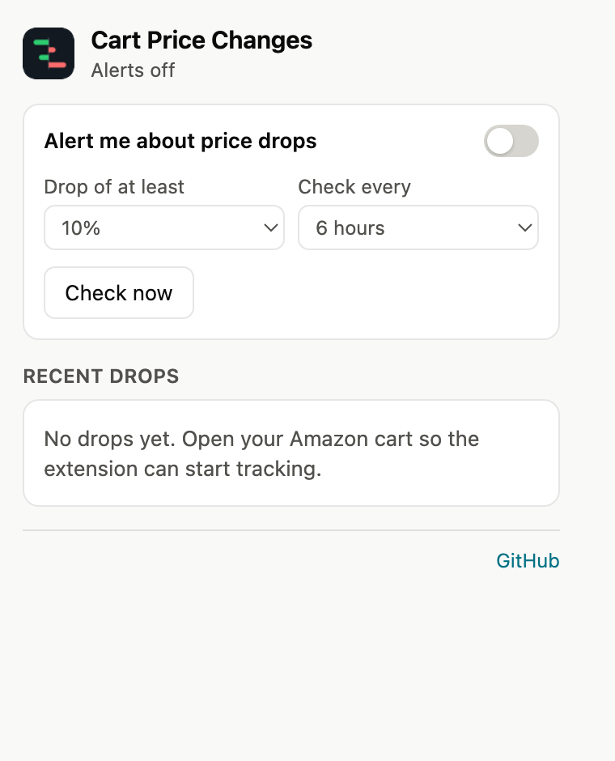
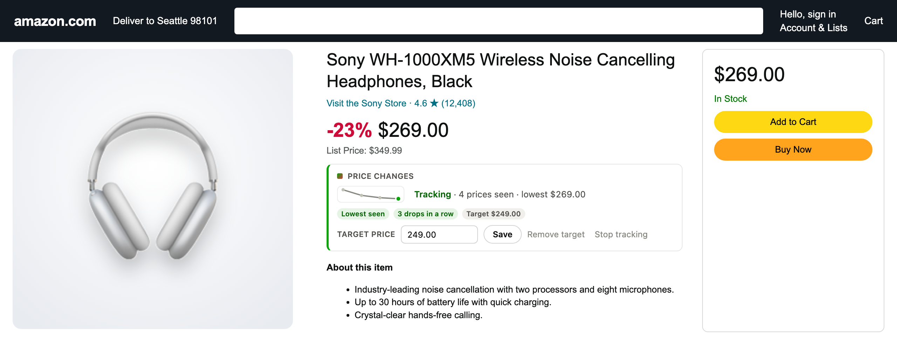

<p align="center">
  
</p>

<h1 align="center">Cart Price Changes for Amazon</h1>

<p align="center">
  Every price move in your Amazon cart and saved-for-later list, as cards or a table, with history, targets and alerts.<br>
  Dia, Chrome, Arc, Brave, Edge, Firefox and Safari. No server, no account, nothing leaves your browser.
</p>

<p align="center">
  <a href="https://github.com/Coursion-Studio/amazon-cart-price-changes/releases/latest"></a>
  <a href="LICENSE"></a>
  
  
</p>

<p align="center">
  
</p>

## The problem

Amazon does tell you when prices in your cart change. It just does it badly:

- **One long sentence per item**, in a wall of yellow text. Twenty items, twenty sentences.
- **Shown once.** Reload the page and the box is gone.
- **Only since you last looked.** A price that moved three times last month shows up as one change, or not at all.
- **Only while you are looking.** Nothing tells you about a drop while the cart is closed.

## What this does instead

It replaces that box with a panel you can read in a second, keeps its own
record so the picture is always there and grows over time, and, if you want,
watches your cart for you between visits.

| | |
|---|---|
| **Cards** | Product picture, new price large, old price struck through, a green or red pill with the change in money and percent, a sparkline of every price seen, and the date. The top edge is green for a drop, red for a rise. |
| **List** | The same data as a dense table: sortable columns, a diverging bar per item, tabular numbers. |
| **Summary row** | The first tile carries the period, the count, the net change, your cart total and a drop-vs-rise bar. *Dropped* and *Increased* are filters. The biggest move each way shows its picture and jumps to the item. |
| **Period** | Today, 2 days, 7 days, 30 days or all time. Each row shows the change over that period, however many steps lie between, and the summary follows. |
| **History** | On every visit the extension reads the current price of every item in your cart and saved-for-later list and records a point when a price moved. Amazon's own notices are folded in. Click any product for its full history. |
| **Alerts** | Opt in from the toolbar popup. The extension then checks your cart on a schedule you choose, with no Amazon tab open, and notifies you when an item drops by your chosen percentage or reaches its target price. The icon shows the number of new drops. |
| **Targets** | A target price per product, set on the product page or in its details on the cart page. It shows as a chip and fires an alert when reached. |
| **Any product page** | A small bar under the price: **Track price** adds the item to the record even if it is not in your cart; once tracked it shows the history, signals and the target editor. |
| **Signals** | A blue dot on everything that changed since your last visit, plus *Lowest seen*, *N drops in a row*, *Back to an earlier price* and *Target reached*. |
| **Also** | Search, sort menu, collapse, CSV export, a diagnostics copy for bug reports, English and Turkish interface following the page language. |

<p align="center">
  
</p>

<p align="center">
  
</p>

<p align="center">
  
</p>

## Install

Pick whichever fits. The panel is the same everywhere; alerts need a
background worker, so the userscript build does not have them.

| Channel | Browsers | Updates | Alerts | How |
|---|---|---|---|---|
| **Chrome Web Store** | Dia, Chrome, Arc, Brave, Edge | Automatic | Yes | Listing in review; the link will appear here |
| **Homebrew** (macOS) | Dia, Chrome, Arc, Brave, Edge | `brew upgrade` | Yes | `brew install Coursion-Studio/tools/amazon-cart-price-changes`, then load the folder it prints |
| **Release zip** | Dia, Chrome, Arc, Brave, Edge | Manual | Yes | Download from [Releases](https://github.com/Coursion-Studio/amazon-cart-price-changes/releases/latest), unzip, load the folder |
| **Firefox zip** | Firefox | Manual | Yes | `…-firefox.zip` from Releases, via `about:debugging` → Load Temporary Add-on |
| **Safari** (macOS) | Safari | Manual | Badge and popup, no notifications | Open `safari/` in Xcode, run the app once, enable the extension in Safari → Settings → Extensions |
| **Userscript** | Any Chromium browser or Firefox with [Tampermonkey](https://www.tampermonkey.net/) or [Violentmonkey](https://violentmonkey.github.io/) | Automatic | No | Open [amazon-cart-price-changes.user.js](https://raw.githubusercontent.com/Coursion-Studio/amazon-cart-price-changes/main/amazon-cart-price-changes.user.js) and confirm |

**Loading a folder** (Homebrew or zip): open `dia://extensions` or `chrome://extensions`,
turn on **Developer mode**, click **Load unpacked**, choose the folder. After an
update, click the reload icon on the extension's card.

Then open your Amazon cart. Scroll through the saved-for-later list once per
visit: Amazon only loads those items as you reach them, and the extension can
only record what is on the page.

## Alerts

<p align="center">
  
</p>

1. Click the extension's icon in the toolbar and turn on **Alert me about price drops**.
   The browser asks for three permissions right then: a schedule (`alarms`),
   the notification itself, and access to the Amazon sites you use. Nothing is
   asked at install, and turning alerts off stops the checks.
2. Pick the drop that counts (5 to 30 percent) and how often to check (3 to 24 hours).
3. **Check now** runs a check immediately and reports how many items it looked at.

On each check the extension fetches your cart page in the background, records
every price the same way a visit would, then fetches the pages of up to eight
tracked products that were not in the cart (oldest first). A notification
fires for each item that dropped by at least your percentage, or fell to its
target price. Each drop is announced once. The icon shows the number of new
drops since you last opened the cart or the popup; the popup lists the recent
drops and your targets.

## Target prices and tracking from product pages

<p align="center">
  
</p>

On any product page a bar appears under the price. **Track price** adds the
item to the record with its current price; from then on every visit to the
page, the cart, or a background check records it. Once tracked, the bar shows
the sparkline, how many prices were seen, the lowest, the signals and the
target editor.

To set a target, type a price next to **Target price** and press Save, either
there or in the product's details on the cart page (the chevron on a card or a
row). The target shows as a chip, turns into *Target reached* when the price
is at or below it, and, with alerts on, fires a notification the moment a
check sees it. **Remove target** clears it; **Stop tracking** forgets the item.

## Signals

| Signal | Meaning |
|---|---|
| Blue dot | Changed since the last time you opened the cart |
| **Lowest seen** | At or below every price recorded for this item (after three sightings) |
| **N drops in a row** | The last three or more recorded prices each lower than the one before |
| **Back to an earlier price** | The current price was seen before, after a different price in between |
| **Target reached** | At or below the target you set |

## How it works

- `content.js` runs on Amazon storefront pages only. On the cart page it reads
  Amazon's price-change notices (if any) and the name, price and picture of
  each item in the cart and saved-for-later lists.
- Every price is stored as a point `{ time, price }` per product in the
  browser's extension storage, keyed by Amazon site. A new point is added only
  when the price moved. Amazon's "was X, now Y" notices add the earlier price
  too.
- For the chosen period, a product's change is the price just before the
  period against the price now. Nothing changed in the period means the
  product is not listed. The cart total compares the same way.
- `background.js` does the scheduled checks described above, using the same
  record. `scan.js` parses the cart and product pages without a DOM, so it
  runs inside a service worker.
- Records older than a year are dropped. **Clear history** removes everything;
  **Forget this item** removes one product.

Supported storefronts: amazon.com.tr, amazon.com, .co.uk, .de, .fr, .it, .es,
.nl, .se, .pl, .com.be, .ca, .com.mx, .com.br, .com.au, .co.jp, .in, .sg, .ae,
.sa and .eg. Prices are parsed in both `1.234,56` and `1,234.56` styles.

## Permissions and privacy

| Permission | When | Why |
|---|---|---|
| `storage` | Install | Its own record: prices, targets, preferences |
| `alarms` | When you turn alerts on | The check schedule |
| `notifications` | When you turn alerts on | The alert itself |
| Amazon sites | When you turn alerts on | Fetching your cart and product pages in the background |

Nothing leaves your browser. No account, no server, no analytics. The only
network requests go to your Amazon site: product pictures, a product's own page
when a remembered item has no picture, and, with alerts on, your cart page and
tracked product pages on the schedule you chose. Details in
[PRIVACY.md](PRIVACY.md).

## Development

```bash
npm test               # unit tests for parsing, history, signals and the page parsers (node --test)
npm run shot           # screenshot the demo cart at test/cart/fixture.html
npm run store-shots    # 1280x800 store screenshots, README images and the promo tile
npm run package        # userscript + Chrome/Edge/Dia zip + Firefox zip into dist/
npm run safari         # regenerate safari/ (Xcode project) from the packaged extension and build it
scripts/update-formula.sh   # after a GitHub release: refresh the Homebrew formula
```

Layout:

```
manifest.json        MV3 manifest: content script on Amazon storefronts, worker, popup, optional permissions
parse.js             pure: prices, direction words, history model, periods, signals, cart totals, formatting
scan.js              pure: cart page and product page HTML parsers for the worker
content.js           the page: find Amazon's notices and list items, build and refresh the panel
background.js        alerts: scheduled checks, notifications, toolbar badge
popup.html/js/css    toolbar popup: alert settings, check now, recent drops, targets
styles.css           scoped to #apc-panel
safari/              Xcode project for Safari, generated by scripts/safari.sh
test/                parse and scan unit tests; make-fixture.py generates the demo cart
scripts/             package, userscript build, screenshots, Safari project, Homebrew formula update
store/               Chrome Web Store assets and listing text (store/listing.md)
```

The demo cart accepts `?seed=1` (seeded history), `&nolive=1` (no Amazon box),
`&win=7d`, `&view=list`, `&filter=down`, `&expand=<ASIN>` and `&shot=1`
(compact layout for screenshots). The content script treats it as a cart page
because it lives under a `cart/` path. Releases are listed in
[CHANGELOG.md](CHANGELOG.md).

## Questions

**How do I set a target price?** On the product's page, in the bar under the
price; or on the cart page, open the product's details and use the target
field.

**Only a few items show up.** The record starts when you install. Amazon's own
box only lists what changed since you last looked; from now on every visit
adds to the history, and the period selector widens the view.

**No picture for an item.** Amazon loads pictures lazily; the extension picks
them up as they arrive. For an item that is not on the page, it tries Amazon's
image service by ASIN and then fetches that product's page on the same site
once to read its picture. If a storefront's markup differs, click **Copy
diagnostics** in the footer and open an issue with the result.

**Check now says it looked at 0 items.** The background request did not get a
cart page, usually because the Amazon session cookie was not sent or Amazon
served a sign-in page. Open the cart once in a tab, then try again; if it
persists, attach the diagnostics to an issue.

**I updated and my history is gone.** Version 1.2.0 moved the record from the
page's local storage to extension storage. It migrates on the first cart
visit after the update; open the cart once.

**Safari?** Open the project in `safari/` with Xcode, run it once, then enable
the extension in Safari → Settings → Extensions (for an unsigned local build,
also tick Develop → Allow Unsigned Extensions). Safari has no notification API
for extensions, so there the badge and the popup carry the news.

## Not affiliated with Amazon

Amazon is a trademark of Amazon.com, Inc. This is an independent tool and is
not endorsed by or affiliated with Amazon.

MIT © [Coursion Studio](https://coursion.studio)
